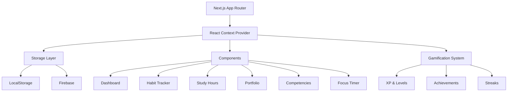
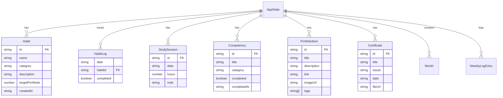

# Progress Tracker – Premium Edition

A comprehensive 12-month civil engineering development programme tracker built with Next.js, featuring premium UI/UX, gamification, and mobile-first design.

## Features

### Core Functionality
- ✅ **Monthly Progress Tracking** - Track 12 months of development goals with detailed tasks
- ✅ **Habit Tracker** - Track daily habits with 7-day mini-grid and streak calculation
- ✅ **Portfolio Tracking** - Monitor portfolio projects with custom item support
- ✅ **Competency Checklist** - 17 essential competencies across 5 categories
- ✅ **Weekly Hours Logging** - Log daily hours with focus tracking
- ✅ **Focus Timer** - Pomodoro timer with auto-logging (25/5/15 minute intervals)
- ✅ **Certificates** - Track professional certifications with skills and dates

### Premium Features
- ✅ **Mobile Bottom Navigation** - App-like mobile experience with auto-hide behavior
- ✅ **Analytics Dashboard** - Visual progress charts and insights with Recharts
- ✅ **Gamification** - XP system, streaks, achievements, and badges
- ✅ **Dark/Light Mode** - Theme support with system preference
- ✅ **Responsive Design** - Works on desktop, tablet, and mobile (320px+)
- ✅ **Premium UI Effects** - Glassmorphism, animations, micro-interactions
- ✅ **Export/Import** - Backup and restore your data as JSON
- ✅ **PWA Support** - Install as a progressive web app
- ✅ **Code Splitting** - Optimized bundle with dynamic imports

### Data Management
- Local storage with debounced writes (300ms) for performance
- Firebase cloud sync (optional, with authentication)
- Versioned schema with migration support
- Automatic data validation

## Tech Stack

- **Framework**: Next.js 16.4.3 (App Router)
- **UI**: Tailwind CSS, Radix UI, shadcn/ui
- **Charts**: Recharts
- **Authentication**: Firebase Auth (optional)
- **Database**: Firebase Firestore (optional) / LocalStorage (default)
- **State Management**: React Context with debounced persistence
- **Animations**: Framer Motion, GSAP
- **Icons**: Lucide React
- **Fonts**: Inter, Playfair Display (via next/font)

## Architecture Overview



### Data Model



## Getting Started

### Prerequisites

- Node.js 18+ installed
- npm or yarn package manager

### Installation

1. Clone the repository:
```bash
git clone https://github.com/YOUR_USERNAME/progress-tracker.git
cd progress-tracker
```

2. Install dependencies:
```bash
npm install
```

3. Set up environment variables (optional - for Firebase sync):
```bash
cp .env.example .env.local
```

4. Run the development server:
```bash
npm run dev
```

5. Open [http://localhost:3000](http://localhost:3000) in your browser

## Deployment

This project is deployed on Vercel at https://progress-tracker-two-alpha.vercel.app

### Quick Deploy to Vercel

1. Push code to GitHub
2. Import repository in Vercel
3. Add Firebase environment variables (optional)
4. Deploy!

## Environment Variables (Optional - for Firebase Sync)

```env
NEXT_PUBLIC_FIREBASE_API_KEY=your_api_key
NEXT_PUBLIC_FIREBASE_AUTH_DOMAIN=your_project.firebaseapp.com
NEXT_PUBLIC_FIREBASE_PROJECT_ID=your_project_id
NEXT_PUBLIC_FIREBASE_STORAGE_BUCKET=your_project.firebasestorage.app
NEXT_PUBLIC_FIREBASE_MESSAGING_SENDER_ID=your_sender_id
NEXT_PUBLIC_FIREBASE_APP_ID=your_app_id
NEXT_PUBLIC_FIREBASE_MEASUREMENT_ID=your_measurement_id
```

## Project Structure

```
progress-tracker/
├── app/                 # Next.js app directory
│   ├── layout.tsx      # Root layout with providers
│   ├── page.tsx        # Main dashboard page
│   ├── globals.css     # Global styles with design tokens
│   └── friends/        # Friends feature page
├── components/          # React components
│   ├── ui/            # shadcn/ui components
│   ├── HabitTracker.tsx
│   ├── PortfolioPanel.tsx
│   ├── FocusTimer.tsx
│   ├── MobileBottomNav.tsx
│   └── ... (50+ components)
├── lib/                # Utility functions and logic
│   ├── context.tsx    # React Context with state management
│   ├── storage.ts     # LocalStorage with debouncing
│   ├── data.ts       # Domain models and initial data
│   ├── firebase.ts   # Firebase integration
│   └── ... (30+ utility files)
├── types/              # TypeScript type definitions
│   └── domain.ts     # Core domain types
├── public/             # Static assets
│   ├── manifest.json  # PWA manifest
│   └── ... (images, icons)
├── .env.local          # Environment variables (not committed)
└── package.json        # Dependencies
```

## Available Scripts

- `npm run dev` - Start development server
- `npm run build` - Build for production
- `npm start` - Start production server
- `npm run lint` - Run ESLint

## Screenshots

### Desktop View
<!-- TODO: Add desktop screenshot -->


### Mobile View
<!-- TODO: Add mobile screenshot -->


### Focus Timer
<!-- TODO: Add focus timer screenshot -->


## Performance Optimizations

- **Code Splitting**: Dynamic imports for heavy components (Portfolio, Certificates, ProductivityInsights)
- **Debounced Storage**: 300ms debounce on localStorage writes to prevent thrashing
- **Memoization**: React.memo on expensive components
- **Optimized Images**: Next.js Image with lazy loading
- **Bundle Size**: Recharts and Framer Motion dynamically imported

## Roadmap

See [BACKLOG.md](./BACKLOG.md) for prioritized features and improvements.

## Contributing

This is a personal project, but suggestions and improvements are welcome via GitHub issues.

## License

This project is private and for personal use.

## Support

For issues or questions, please refer to the documentation in the project.

---

Built with ❤️ using Next.js, TypeScript, and Tailwind CSS
